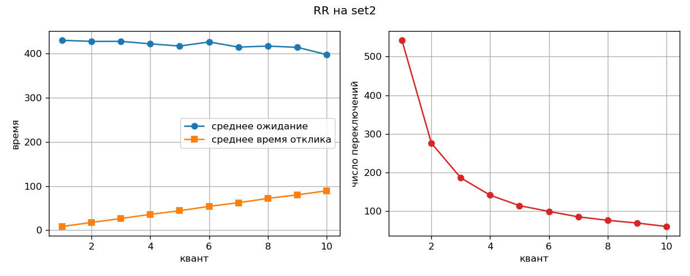

# Практическая работа № 5. Симулятор планирования CPU (вариант B)

Среда: Ubuntu (WSL2) на Windows 11, Python 3 (matplotlib для графика).

Файлы: `sched.py` (симулятор), `gen_sets.py` (генерация наборов), `rr_plot.py` (график для RR), `set1.txt`, `set2.txt`, `set3.txt`, `set4_starve.txt`, `rr_plot.png`.

Запуск: `python3 sched.py --algo rr --quantum 3 set1.txt`. Флаги: `--algo {fcfs,sjf,srtf,priority,rr,all}`, `--quantum N` (для RR), `--aging N` (старение для priority). Режим `--algo all` печатает сводную таблицу по всем алгоритмам.

## 1. Реализация

Единая функция `simulate(processes, algorithm, **params)` возвращает список интервалов `(pid, начало, конец)`. Все метрики считаются по этим интервалам, поэтому они одинаково определены для всех алгоритмов.

- **FCFS, SJF:** невытесняющие, выбор процесса при освобождении CPU.
- **SRTF, Priority:** вытесняющие, симуляция по тактам: на каждом такте из прибывших выбирается лучший процесс (SRTF: минимальный остаток, Priority: минимальное число = высший приоритет).
- **RR:** очередь `deque`; по соглашению из условия процесс, прибывший в момент окончания кванта, ставится в очередь раньше вытесненного.
- **Aging (старение):** каждые N тактов ожидания в очереди приоритет процесса улучшается на 1 (не ниже 0).

Метрики:
- оборот = завершение − прибытие;
- ожидание = оборот − burst (ожидание не равно «завершение − прибытие», это оборот);
- отклик = первый запуск − прибытие;
- загрузка CPU = время работы / общее время × 100%;
- переключения = число смен процесса между соседними интервалами.

Наборы: `set1` контрольный из условия (приоритеты в условии не заданы, выбраны произвольно: 3, 1, 4, 2; на FCFS/SJF/SRTF/RR не влияют). `set2` и `set3` не были приложены к заданию, поэтому сгенерированы `gen_sets.py` (seed = 5): set2 это 20 CPU-bound процессов (burst 20–40, прибытие 0–20), set3 это 19 коротких (burst 1–6) и один длинный (burst 100, прибытие 0). `set4_starve.txt` специальный набор для голодания (см. раздел 5).

## 2. Сверка с эталоном (set1)

```
$ python3 sched.py --algo srtf set1.txt
Гант: [0-1]P1 [1-5]P2 [5-10]P4 [10-17]P1 [17-26]P3
Среднее ожидание: 6.50 | средний оборот: 13.00 | ...

$ python3 sched.py --algo rr --quantum 3 set1.txt
Гант: [0-3]P1 [3-6]P2 [6-9]P3 [9-12]P4 [12-15]P1 [15-16]P2 [16-19]P3 [19-21]P4 [21-23]P1 [23-26]P3
Среднее ожидание: 13.50 | средний оборот: 20.00 | ...
```

| Алгоритм | Ожидание (получено) | Оборот (получено) | Эталон | Совпало |
|---|---|---|---|---|
| SRTF | 6.50 | 13.00 | 6,5 / 13,0 | да |
| RR (q=3) | 13.50 | 20.00 | 13,5 / 20,0 | да |
| FCFS | 8.75 | 15.25 | 9,25 / 15,75 | нет (см. ниже) |

**Расхождение по FCFS не ошибка кода, а неточность эталона в условии.** Ручной расчёт по диаграмме: P1 [0–8], P2 [8–12], P3 [12–21], P4 [21–26].
- Ожидание: 0, 8−1 = 7, 12−2 = 10, 21−3 = 18; сумма 35; 35 / 4 = **8,75** (в условии 9,25).
- Оборот: 8, 12−1 = 11, 21−2 = 19, 26−3 = 23; сумма 61; 61 / 4 = **15,25** (в условии 15,75).

Эталоны SRTF и RR (где расхождений нет) подтверждают, что соглашение об очереди в RR реализовано верно.

## 3. Метрики на наборах

Загрузка CPU везде 100%: процессы приходят плотно, простоев нет, а переключения в симуляции ничего не стоят.

**set1** (4 процесса)

| Алгоритм | Ожидание | Оборот | Отклик | CPU, % | Переключений |
|---|---|---|---|---|---|
| FCFS | 8.75 | 15.25 | 8.75 | 100.0 | 3 |
| SJF | 7.75 | 14.25 | 7.75 | 100.0 | 3 |
| SRTF | 6.50 | 13.00 | 4.25 | 100.0 | 4 |
| Priority | 6.50 | 13.00 | 4.25 | 100.0 | 4 |
| RR (q=3) | 13.50 | 20.00 | 3.00 | 100.0 | 9 |

**set2** (20 процессов, CPU-bound)

| Алгоритм | Ожидание | Оборот | Отклик | CPU, % | Переключений |
|---|---|---|---|---|---|
| FCFS | 238.75 | 266.10 | 238.75 | 100.0 | 19 |
| SJF | 215.60 | 242.95 | 215.60 | 100.0 | 19 |
| SRTF | 215.60 | 242.95 | 215.60 | 100.0 | 19 |
| Priority | 243.45 | 270.80 | 239.05 | 100.0 | 20 |
| RR (q=3) | 427.25 | 454.60 | 26.55 | 100.0 | 186 |

**set3** (19 коротких + 1 длинный)

| Алгоритм | Ожидание | Оборот | Отклик | CPU, % | Переключений |
|---|---|---|---|---|---|
| FCFS | 108.45 | 116.65 | 108.45 | 100.0 | 19 |
| SJF | 97.25 | 105.45 | 97.25 | 100.0 | 19 |
| SRTF | 11.35 | 19.55 | 8.05 | 100.0 | 22 |
| Priority | 97.30 | 105.50 | 96.70 | 100.0 | 22 |
| RR (q=3) | 28.20 | 36.40 | 16.80 | 100.0 | 32 |

Наблюдения:
- **set3:** лучший по ожиданию SRTF (11.35). FCFS (108.45) и SJF (97.25) почти одинаково плохи: длинный P1 приходит в момент 0, когда он единственный, и невытесняющий SJF не может его снять, пока он не отработает 100 тактов; все короткие стоят за ним. SRTF вытесняет P1 каждым коротким процессом. RR (28.20) вторым: короткие процессы получают CPU быстро, не дожидаясь P1. Priority (97.30) от длины burst не зависит, приоритеты в наборе случайные, поэтому короткие процессы защищены не лучше, чем в FCFS.
- **set2:** SJF и SRTF совпали (215.60, 19 переключений = 20 процессов подряд без вытеснений). По-видимому, на этих данных новый процесс ни разу не оказался короче остатка работающего (все burst в диапазоне 20–40), поэтому вытеснение не срабатывало. У RR самое большое ожидание (427.25) и самый маленький отклик (26.55); причина в разделе 4.
- **set1:** Priority совпал с SRTF случайно: выбранные приоритеты (3, 1, 4, 2) на этих данных дают тот же порядок.

## 4. RR: квант 1…10 на set2



```
q= 1  ожидание=429.50  отклик=8.55   переключений=542
q= 2  ожидание=427.20  отклик=17.70  переключений=276
q= 3  ожидание=427.25  отклик=26.55  переключений=186
q= 4  ожидание=421.65  отклик=36.00  переключений=141
q= 5  ожидание=416.65  отклик=44.20  переключений=114
q= 6  ожидание=425.85  отклик=54.00  переключений=99
q= 7  ожидание=414.30  отклик=62.35  переключений=85
q= 8  ожидание=416.55  отклик=72.00  переключений=76
q= 9  ожидание=413.80  отклик=80.10  переключений=69
q=10  ожидание=397.30  отклик=89.20  переключений=60
```

**Число переключений падает как 1/q.** Суммарный burst набора B ≈ 543 (при q=1 каждый такт это отдельный квант, переключений 542 = B − 1). Квантов при размере q приблизительно B / q, значит и переключений примерно столько же: q=2 → 543 / 2 ≈ 272 (измерено 276); q=5 → 543 / 5 ≈ 109 (114); q=10 → 543 / 10 ≈ 54 (60). Небольшой избыток возникает из-за неполных последних квантов у процессов.

**Время отклика растёт примерно линейно с q.** Если бы все N = 20 процессов пришли в момент 0, процесс с номером k (k = 0…19) впервые получил бы CPU через k·q, и среднее было бы q·(0 + 1 + … + 19) / 20 = q · 190 / 20 = 9.5·q. Для q = 10 это 95, измерено 89.2. Чуть меньше, потому что процессы приходят в течение первых 20 тактов, и поздний видит перед собой не всю очередь.

**Среднее ожидание почти не зависит от q (429 → 397).** Малый квант заставляет все процессы двигаться вместе, и они завершаются почти одновременно, ближе к концу всей работы (около 540). FCFS завершает процессы по одному, и средний процесс заканчивается примерно на полпути (ожидание 238.75). Чем больше квант, тем ближе RR к FCFS, поэтому ожидание медленно ползёт вниз.

**Компромисс:** маленький квант даёт быстрый отклик (8.55 при q=1 против 89.2 при q=10, то есть интерактивным задачам лучше), но в 9 раз больше переключений (542 против 60). В симуляции переключение бесплатное, в реальной ОС каждое стоит времени (сохранение/загрузка регистров, сброс кэшей), поэтому слишком малый квант тратит CPU впустую. Большой квант экономит переключения, но отклик ухудшается, и RR вырождается в FCFS.

## 5. Старение (aging) и голодание

Набор `set4_starve.txt`: процесс P1 (burst 5, приоритет 5, самый невыгодный) и поток из 12 важных процессов H1…H12 (burst 4, приоритет 1). Каждый H приходит ровно в момент завершения предыдущего, поэтому CPU у них никогда не освобождается.

**Без старения** (`--algo priority`):
```
Гант: [0-4]H1 [4-8]H2 ... [44-48]H12 [48-53]P1
P1   прибыт.=0  burst=5  конец=53  ожид.=48  оборот=53  отклик=48
Среднее ожидание: 3.69 | средний оборот: 7.77 | переключений: 12
```
P1 получает CPU только после всех 12 H (ожидание 48). Если бы поток H не заканчивался, P1 не запустился бы никогда. Это голодание. Среднее при этом выглядит хорошо (3.69), поскольку 12 процессов вообще не ждут: средняя метрика скрывает, что один процесс страдает.

**Со старением** (`--aging 3`: каждые 3 такта ожидания приоритет улучшается на 1):
```
Гант: [0-4]H1 [4-8]H2 [8-12]H3 [12-15]P1 [15-18]H4 [18-20]P1 [20-21]H4 [21-25]H5 ... [49-53]H12
P1   прибыт.=0  burst=5  конец=20  ожид.=15  оборот=20  отклик=12
Среднее ожидание: 4.62 | средний оборот: 8.69 | переключений: 14
```
Приоритет P1 за 12 тактов ожидания улучшился с 5 до 1 (на 4 шага по 3 такта), сравнялся с H-процессами, а при равенстве выигрывает пришедший раньше. P1 запустился в момент 12. На 15-м такте его вытеснил H4: он сам прождал 3 такта и тоже «состарился» (приоритет упал до 0). P1 завершился в момент 20 вместо 53 (ожидание 15 вместо 48).

**Цена старения:** P1 отработал 5 тактов раньше, поэтому каждый из девяти H4…H12 сдвинулся на те же 5 тактов (у каждого ожидание 0 → 5). Среднее ожидание: до = 48 / 13 ≈ 3.69, после = (15 + 9·5) / 13 = 60 / 13 ≈ 4.62. Средний показатель вырос на 0.93, и это плата за то, что никто не голодает.

## 6. Выводы

- Для минимального ожидания при известных burst лучше всего SRTF (set3: 11.35 против 108.45 у FCFS), но он требует знать длину burst заранее.
- FCFS прост, но страдает от «эффекта конвоя»: короткие процессы застревают за длинным (set3).
- RR даёт лучший отклик и справедливость между процессами, но большое среднее ожидание на CPU-bound нагрузке и много переключений; квант это компромисс между откликом и накладными расходами.
- Приоритетное планирование без старения допускает голодание, старение лечит его за небольшую цену в средних метриках.

## Контрольные вопросы

**1. Почему SJF нельзя применять в реальной ОС напрямую?**
SJF выбирает процесс с наименьшим burst, а ОС не знает заранее, сколько процессу ещё понадобится CPU: это зависит от входных данных и поведения программы. На практике burst оценивают по истории экспоненциальным сглаживанием: τₙ₊₁ = α·tₙ + (1 − α)·τₙ, где tₙ реальная длина последнего burst, τₙ прежний прогноз, α ∈ [0, 1] вес свежих данных. Пример: τ = 10, фактически tₙ = 6, α = 0.5 даёт τₙ₊₁ = 0.5·6 + 0.5·10 = 8. Кроме того, чистый SJF голодает длинные процессы, если короткие идут непрерывно.

**2. Что происходит при кванте RR, стремящемся к бесконечности?**
Квант перестаёт когда-либо истекать раньше завершения процесса (точнее, при q ≥ максимального burst), поэтому никто не вытесняется по таймеру, и процессы выполняются до конца в порядке прихода, то есть RR вырождается в FCFS. Тенденция видна на графике: с ростом q переключения падают (до N − 1 = 19, как у FCFS), ожидание медленно приближается к значению FCFS (238.75), а отклик растёт (до 238.75 у FCFS).
